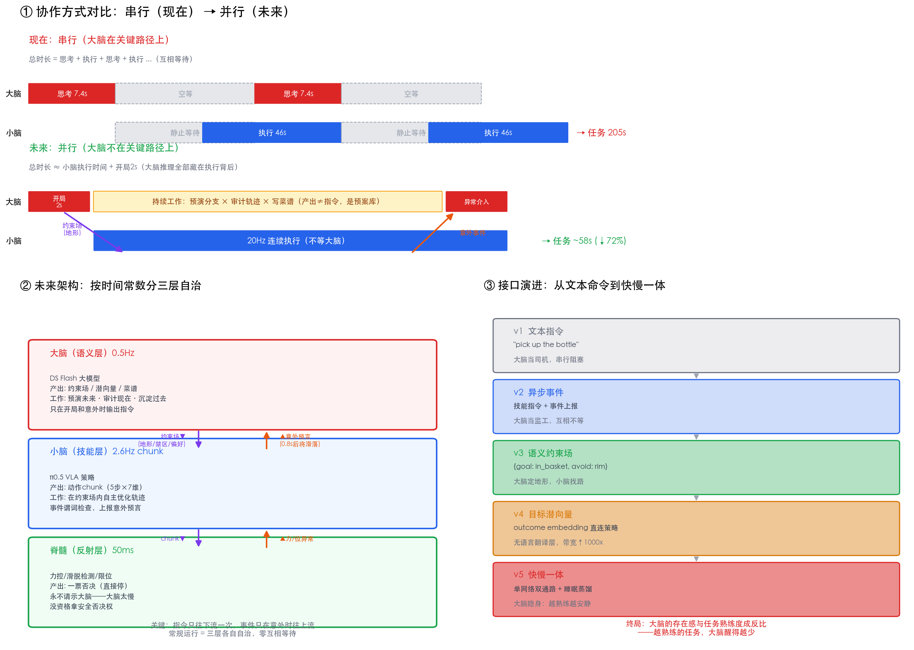

# RPent × DeepSeek V4.1 Flash 性能评测报告

对 RPent 具身智能体框架在 155 NPU 服务器 + DeepSeek V4.1 Flash（api.deepseek.com）上的端到端性能评测，
任务为 LIBERO `libero_object_swap`。

## 报告文件

| 文件 | 任务 | 轮次 | 端到端 | 说明 |
|---|---|---|---|---|
| `ds_flash_t2_parallel_report.html` | t2/s0（沙拉酱） | 15 | 205.3s | **最终版**：Files API + 禁裁剪 + 流式转换 + 并行传图 |
| `ds_flash_v5_report.html` | t2/s0 | 15 | 182.5s | 流式转换首测 |
| `ds_flash_t8_report.html` | t8/s0（巧克力布丁，复杂任务） | 17 | 399.7s | 复杂任务对照 |
| `ds_flash_10swap_t0_report.html` | **libero_10_swap t0/s0（双物体长程任务）** | **34** | **888.7s** | 长程多步压测：34轮无服务端退化 |

报告为自包含 HTML（内嵌双视角视频 + 全部上下文图片 + 中文翻译），浏览器直接打开。

## 核心结论

### 测量口径（最重要的教训）

Agent 使用非流式请求时，代理记录的 `ttft_s` 是**完整响应时间（含 thinking/decode 生成）**，不是真 TTFT。
修复：代理内部将非流式请求转流式转发，首 SSE chunk 时间为真 TTFT，收完组装回非流式响应。

### TTFT 三分解（全部实测）

```
TTFT = 代理传图(并行, 仅新图轮) + chat上传(0.2MB请求体) + DS服务端(prefill+排队)
       0.34s/轮                  0.65s/轮                0.46s/轮 ← 全程稳定
```

**真 TTFT p50 = 1.07~1.27s；DS 服务端 prefill p50 ≈ 0.4~0.5s，与 prompt 大小、图片数量无关**
（70K prompt + 11 张图的轮次也仅 0.34s）。

### 每轮耗时公式（实测均值）

```
T_llm = TTFT + T_think + T_decode = 7.4 s/轮
        1.45s(11%)  4.6s(33%)    1.3s(10%)
去除 Thinking 后单轮推理 ≈ 2.8s
```

### 关键发现

1. **Files API（base64→file_id）**：请求体 4.6MB→0.2MB（↓96%），上传 7.8s→0.5s/轮。
   唯一解决的是传输瓶颈（155→DS 带宽 ~2MB/s），不改变服务端处理。
2. **禁用 RPent 图片裁剪**（`_MAX_HISTORY_IMAGE_BYTES` 4MB→1TB）：图片原位保留，
   前缀缓存全程 96-100% 命中、零断裂。裁剪历史图片会破坏 KV cache 前缀匹配。
3. **并行图片上传**：代理侧新图上传串行→并行，实测 2.8x（3 张：1.9s→0.7s）。
4. **慢轮根因 = thinking Token 多**（生成时间），不是请求内容/图片位置/缓存问题。
   之前排查的图片位置/跨模态 attention/tool_call 验证均为口径错误引出的幽灵问题。
5. **π0.5 VLA 推理**（155 NPU）：384ms/chunk（5 步动作，摊 76.7ms/action，2.61 chunk/s），
   方差 <1ms 极稳定；pi0_pick 的 46s 中推理仅占 15%，85% 是仿真器 CPU 软件渲染步进（真机无此开销）。
6. **长程任务无退化**：34 轮双物体任务中 DS 服务端 prefill 依旧 ~0.48s——任务复杂度只增加轮次，
   不降低单轮服务质量（LLM 侧随轮次线性扩展）。

### 端到端耗时构成

```
工具执行(仿真世界推进) ~48%  ← 固有成本，真机同样存在
Thinking 生成          ~23%  ← LLM 侧最大可压缩项（reasoning_effort=low）
TTFT(传图+上传+服务端) ~14%  ← DS 服务端仅占 4%
Decode                 ~9%
```

## 大小脑协同的技术评估



DS（0.5Hz 语义决策）与 π0.5（20Hz 闭环控制）频率差 40 倍——不是工程障碍，而是架构的自然分界线：
按时间常数分三层自治（大脑语义层 / 小脑技能层 / 脊髓反射层），大脑从"逐步指挥"退位为
"定约束场 + 预演分支 + 审计轨迹 + 沉淀菜谱"，思考藏在执行背后。

## 工具链（`tools/`，可直接复用）

- `files_proxy.py`（v3.1）：Files API 透明代理。功能：base64→file_id（hash去重+并行上传）、
  非流式→流式转换（测真实TTFT）、TTFT三分解计时（proxy_prep_s/upload_s/api_wait_s）、
  first_content_s（thinking结束点）、全量IO日志。跑法：
  `python3 files_proxy.py --port 8788 --upstream https://api.deepseek.com --log llm.jsonl`
- `generate_report.py`：本仓库全部 HTML 报告的生成器（编辑顶部 CONFIG 指向数据文件后运行）
- `translate_rounds.py`：逐轮轨迹中文翻译（thinking+正文+输入），幂等缓存
- `pi0_bench.py`：π0.5 VLA 推理延迟基准（直连 vla.predict，384ms/chunk 实测来源）

测量口径规范与模板见 skill：`llm-perf-report`。

---
2026-10-11 · 155 NPU · DeepSeek V4.1 Flash · RPent
